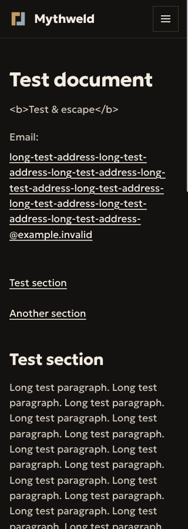
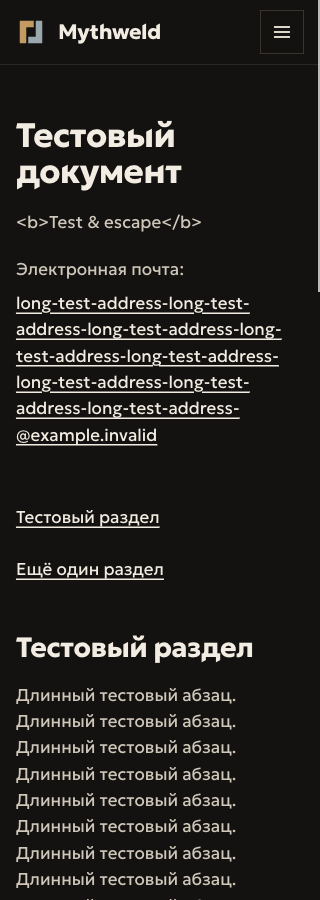
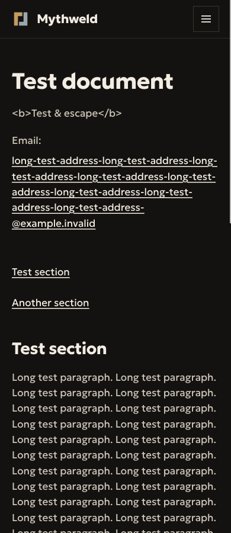
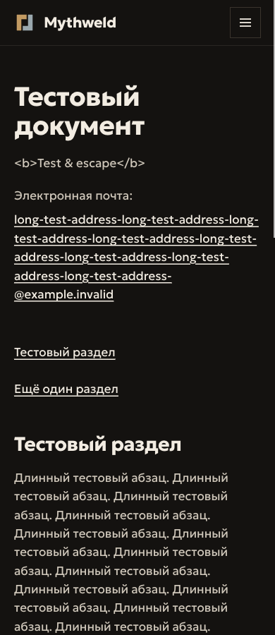

# Проверка технического каркаса — Issue #29

2026-11-02, локальный Chromium. Это **синтетические UI-фикстуры** из
`tests/fixtures/legal.ts`, а не юридические документы, утверждённый контакт или
редакционная дата Mythweld. Скриншоты показывают реальный рендер компонентов,
не макет продукта.

HTML получен через Astro Container API, стили компонента — штатным Astro-компилятором;
общие стили, шрифты и скрипт меню — из локальной сборки. Временные HTML-файлы
находились вне `dist/`, просмотр выполнялся только через `127.0.0.1`.
Файлы маршрутов Astro и публичный dev-preview не создавались.

| Проверка                                           | Результат                                                                       |
| -------------------------------------------------- | ------------------------------------------------------------------------------- |
| Privacy и Contact × EN/RU × 320/390 px (8 случаев) | `scrollWidth === innerWidth`, горизонтального скролла нет                       |
| Длинный URL и email                                | Переносятся внутри колонки; ширина колонки 288 px / 350 px                      |
| Ссылки внутри документа                            | Во всех восьми случаях размеры целей не меньше 44×44 px                         |
| Клавиатура, RU Contact, 390 px                     | Tab → видимый skip-link, Enter → main, Tab → email; видимая обводка фокуса 2 px |
| Цвета                                              | Существующие текстовые токены на `--color-bg`; новые цвета/токены не добавлены  |

Terms использует ту же разметку документа, что и Privacy; все три типа и обе
локали дополнительно проверяются в `tests/legal-components.test.ts`.
После утверждения реального текста нужен повторный просмотр шести будущих страниц.

| Ширина | EN                                        | RU                                        |
| ------ | ----------------------------------------- | ----------------------------------------- |
| 320 px |  |  |
| 390 px |  |  |
